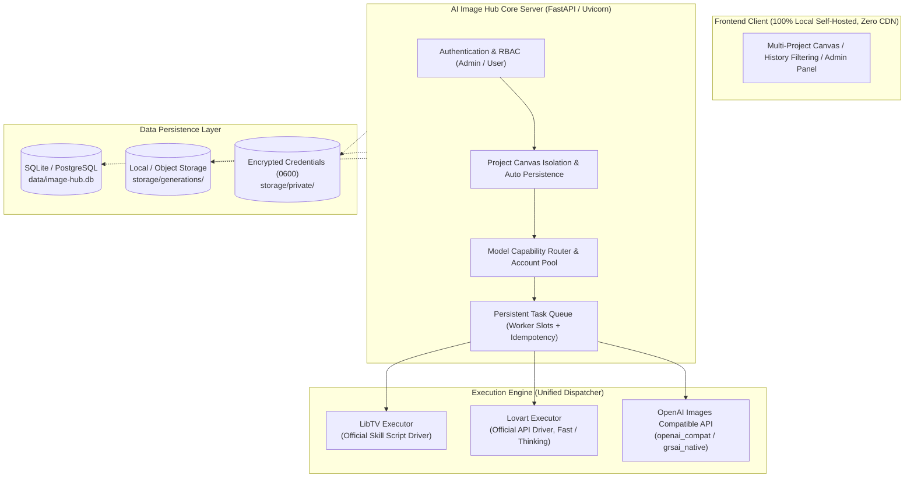

# XGM AI Image Hub

[English](README.md) | [简体中文](README.zh-CN.md)

> A unified, self-hosted multi-platform AI image generation workspace integrating LibTV, Lovart, and OpenAI Images compatible protocols.

[](https://www.python.org/)
[](https://docs.astral.sh/uv/)
[](https://www.docker.com/)
[](LICENSE)
[](#privacy--security-boundaries)

---

## 📌 Project Overview & Core Principles

Mainstream AI image generation services (LibTV, Lovart, upstream commercial relays) diverge substantially in prompt syntaxes, authentication handshakes, task polling lifecycle, and resolution standards. **XGM AI Image Hub** delivers an out-of-the-box, fully private foundation designed for creators, teams, and enterprises:

1. **Raw Prompt Fidelity (No Prompt Distortion)**: Never inject unprompted LLM prompt expansions or invisible rewriting by default. What you prompt is what you generate.
2. **Multi-Platform & Multi-Protocol Convergence**: Simultaneously encapsulates LibTV and Lovart official skill drivers alongside standard OpenAI Images (`openai_compat`) and GRS-AI Native (`grsai_native`) endpoints.
3. **Multi-Account Pools & Workspace Isolation**: Clean multi-account segregation, automatic per-project canvas draft persistence, and provider account pooling (automatic rotation upon quota exhaustion).
4. **100% Self-Contained & Air-Gapped Ready**: Frontend features **zero CDN dependencies, zero external Google Fonts, and zero telemetry tracking**. Core credentials reside strictly on the server-side, compliant with strict private cloud and enterprise audit requirements.

---

## 🏗️ Architecture Overview



---

## ✨ Key Features

### 🎨 Creator Workspace
- **Project-Level Infinite Canvas**: Each project corresponds to an isolated, infinite draft workspace. Prompts, generation tasks, reference assets, and historical runs stay strictly segregated.
- **Real-Time Draft Auto-Persistence**: Automatically saves parameter changes on the fly. Supports up to 14 reference images with strict server-side MIME, resolution, and payload validation.
- **Comprehensive History & Tri-State Tagging**: Full-text prompt search, platform-specific filters, status badges, and one-click quality ratings (**"Adopted / Liked / Disliked"**).
- **Static Frontend Showcase**: Shipped with a built-in `docs/` static demo that can be previewed directly via GitHub Pages using local mock fixtures.

### ⚙️ Platform & Model Orchestration
- **Three Core Executor Implementations**:
  - **LibTV**: Direct invocation via the official `libtv-skill` script without requiring external CLI wrappers.
  - **Lovart**: Dual-mode execution (`fast` for swift iteration, `thinking` for deep compositional planning) with configurable timeouts.
  - **Universal Image APIs**: Seamless compatibility with standard `openai_compat` (size parameter and single reference image) and `grsai_native` (aspect ratio and multi-image packs).
- **Intelligent Provider Account Pools**: Attach multiple credentials per provider with deterministic ascending routing. Automatic failover occurs *only* when upstream explicitly reports **"Insufficient Quota"**, avoiding duplicate submissions or double billing on already-accepted jobs.
- **Route & Model Identifier Decoupling**: Bind the same model ID to distinct upstream gateways; maps display names to prioritized candidate upstream names (`Candidate Names`).

### 🛡️ Production-Grade Security & Engineering
- **Enforced Cryptographic Entropy**: Startup checks strictly enforce non-default values for `IMAGE_HUB_SESSION_SECRET` and `IMAGE_HUB_BOOTSTRAP_ADMIN_PASSWORD`.
- **Worker Slot Concurrency Isolation**: Concurrency is scheduled via dedicated worker slots (tailored for high-latency, lightweight-CPU image synthesis) paired with per-user active task quotas (HTTP 429 backpressure).
- **Graceful Retries & Deterministic Fail-Fast**: Distinguishes between transient rate-limits (linear/exponential backoff retry) and terminal errors (bad parameters, auth failure, moderation blocks — terminated immediately without wasteful retries).

---

## 🚀 Quick Start

### Method 1: Local Setup (Powered by uv)

We recommend using [`uv`](https://docs.astral.sh/uv/) for high-speed dependency resolution:

```bash
# 1. Clone the repository
git clone https://github.com/Odd-C/xgm-ai-image-hub.git
cd xgm-ai-image-hub

# 2. Prepare environment variables
cp .env.example .env

# 3. Generate secure secrets (required for service boot)
python -c "import secrets; print('IMAGE_HUB_SESSION_SECRET=' + secrets.token_urlsafe(48))"
python -c "import secrets; print('IMAGE_HUB_BOOTSTRAP_ADMIN_PASSWORD=' + secrets.token_urlsafe(16))"

# 4. Sync dependencies and run the server
uv sync --dev
uv run uvicorn image_hub.app:app --host 0.0.0.0 --port 5190
```

Open your browser at `http://localhost:5190` and log in using the administrator credentials configured in your `.env`.

### Method 2: Docker Containerized Deployment

```bash
# Grant execution permissions and run deployment script
chmod +x deploy.sh
./deploy.sh
```

> **Deployment Notes**:
> 1. The container runs as a non-root user (`UID 10001`) by default. Mounted volumes in `data/` and `storage/` will belong to this user. Avoid modifying their permission bits manually.
> 2. Port `5190` binds to `127.0.0.1` by default. For production exposures, place an Nginx / Caddy reverse proxy in front with HTTPS / TLS termination.

---

## 📋 Environment Variables & Model Schema

### Required Security Credentials

| Parameter | Required | Default Placeholder | Description |
| :--- | :---: | :--- | :--- |
| `IMAGE_HUB_SESSION_SECRET` | **Yes** | `replace-with-a-long-random-secret` | Cryptographic secret for signing session cookies. Must be customized. |
| `IMAGE_HUB_BOOTSTRAP_ADMIN_PASSWORD` | **Yes** | `change-me-now` | Initial admin password provisioned during the first database bootstrap. |

### Upstream Executor Settings

```env
# ---- LibTV Executor ----
IMAGE_HUB_LIBTV_SKILL_SCRIPTS=/opt/libtv-skill/scripts
IMAGE_HUB_LIBTV_ACCESS_KEY=your-access-key

# ---- Lovart Executor ----
IMAGE_HUB_LOVART_SKILL_SCRIPT=/opt/lovart-api/scripts/agent_skill.py
IMAGE_HUB_LOVART_ACCESS_KEY=ak_xxx
IMAGE_HUB_LOVART_SECRET_KEY=sk_xxx
IMAGE_HUB_LOVART_THREAD_MODE=fast   # fast | thinking

# ---- Universal Image API Executor ----
IMAGE_HUB_OPENAI_IMAGE_BASE_URL=https://api.openai.com/v1
IMAGE_HUB_OPENAI_IMAGE_API_KEY=sk-xxxx
```

### Advanced 11-Segment Model Specification Syntax

Configure custom image models via `IMAGE_HUB_OPENAI_IMAGE_MODELS` (separate multiple models with commas `,`, and 11 attribute segments with pipe symbols `|`):

```text
ModelID | DisplayName | AspectRatios(;) | Resolutions(;) | MaxRefImages | IsEnabled | QualityTier | ExtraHeaders | RouteBinding | Description | UpstreamCandidates(;)
```

**Example**:
```env
IMAGE_HUB_OPENAI_IMAGE_MODELS=gpt-image-1|GPT Image 1|1:1;16:9|1K;2K|4|true|standard|X-Client:hub|default|Universal Flagship Model|dall-e-3;gpt-image-turbo
```

---

## ⚡ Concurrency & Rate Limiting

| Parameter | Default | Mechanism & Impact |
| :--- | :---: | :--- |
| `IMAGE_HUB_WORKER_CONCURRENCY` | `4` | Number of simultaneous background worker slots. Since generation is mostly I/O waiting, this can be tuned according to upstream capacity. |
| `IMAGE_HUB_MAX_ACTIVE_TASKS_PER_USER` | `5` | Maximum combined active tasks (`queued` + `running`) per user before triggering `HTTP 429`. |
| `IMAGE_HUB_API_REPLY_MODE` | `async` | `async` (returns task ID immediately for status polling) or `sync` (holds request open until complete). |
| `IMAGE_HUB_API_SUBMIT_RETRIES` | `2` | Maximum retry attempts with linear backoff for transient 5xx errors or network interruptions. |

---

## 🧪 Testing & Verification

The codebase maintains strict automated test suites:

```bash
# Code style and type checking
uv run ruff check src tests

# Complete unit & integration test suites (20+ suites)
uv run pytest -q

# Run end-to-end browser canvas regression tests
npx playwright test
```

---

## 🔒 Privacy & Security Boundaries

- **Zero-CDN Architecture**: No CDN font injection, zero external telemetry analytics, zero third-party trackers.
- **Hardened Secret Isolation**: Admin API tokens and provider credentials are kept on disk in `storage/private/` with strict `0600` POSIX permissions, never leaked back to the frontend.
- **Data Sovereignty**: Generated image assets, prompt logs, and project metadata belong entirely to your private host volume.

---

## 📄 License

This project is licensed under the [MIT License](LICENSE).
