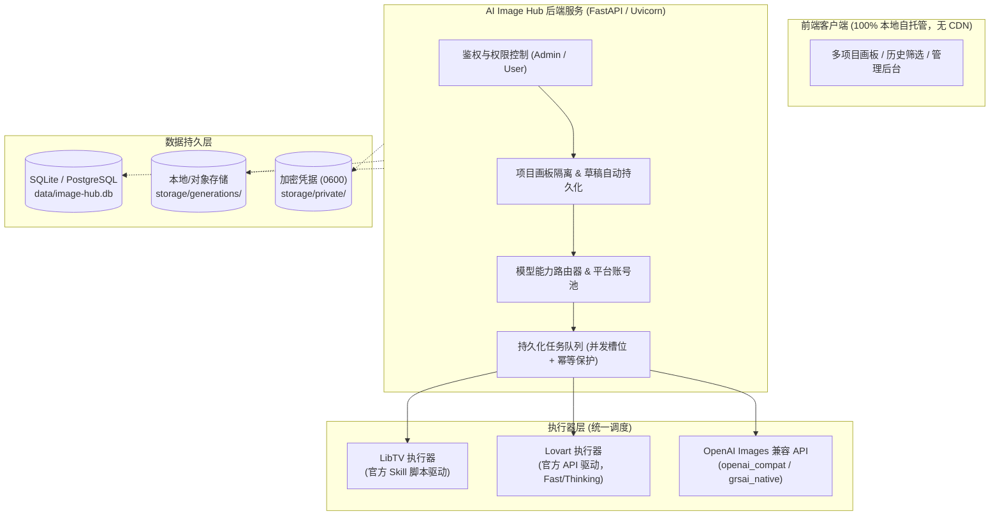

# XGM AI Image Hub

[English](README.md) | [简体中文](README.zh-CN.md)

> 统一接入 LibTV、Lovart 与 OpenAI Images 兼容协议的私有化多平台 AI 生图工作台。

[](https://www.python.org/)
[](https://docs.astral.sh/uv/)
[](https://www.docker.com/)
[](LICENSE)
[](#隐私与安全边界)

---

## 📌 项目定位与核心原则

主流 AI 生图平台（LibTV、Lovart、各商业中转 API）在提示词语法、鉴权流程、任务状态和出图规格上差异巨大。**XGM AI Image Hub** 旨在为企业与个人团队提供开箱即用、完全私有部署的统一生图底座：

1. **原始提示词保真（No Prompt Distortion）**：默认不擅自对提示词做 LLM 扩写或隐式篡改，所写即所出。
2. **多平台与多协议融合**：同时封装 LibTV、Lovart 官方 Skill 驱动，以及 OpenAI Images / GRS-AI Native 两类通用图像 API 协议。
3. **多账号与多租户隔离**：多账号隔离、项目独立画布自动保存、平台账号池（额度耗尽自动切号）。
4. **完全自包含与数据私有**：前端**零 CDN、零外部字体、零数据遥测**，核心凭据仅在服务端持久化，适配严格内网与审计场景。

---

## 🏗️ 整体架构流程



---

## ✨ 核心特性

### 🎨 创作者工作台
- **项目级独立画布**：一个项目固定对应一张无限草稿画布，提示词、生成任务、参考图和结果按项目严格隔离。
- **草稿实时自动持久化**：随改随存，支持多参考图管理（最多支持 14 张，格式/尺寸/体积服务端硬性校验）。
- **生成历史与多维筛选**：提示词全文检索、平台筛选、状态标记，以及**「满意 / 采用 / 不满意」**三态质量标记。
- **静态前端演示**：仓库自带 `docs/` 静态演示站点，可直接通过 GitHub Pages 在线体验纯本地模拟数据。

### ⚙️ 平台与模型调度
- **三类官方与通用执行器**：
  - **LibTV**：通过官方 `libtv-skill` 脚本驱动，无需安装外置命令行客户端。
  - **Lovart**：支持 `fast`（快速出图）与 `thinking`（深度思考构图）双模式及超时保护。
  - **通用图像 API**：无缝支持标准 `openai_compat`（传 size 与单个参考图）与 `grsai_native`（传宽高比与图组）端点。
- **多平台账号池与自动轮换**：同一平台可挂载多组凭据，固定升序路由，仅在上游明确反馈**「额度不足」**时切号，已受理任务绝不重复提交扣费。
- **API 路由与模型名解绑**：同一模型可绑定不同中转路由；支持展示名对应多个优先级候选上游名（`Candidate Names`）。

### 🛡️ 生产级安全与工程加固
- **强制随机 Secret 校验**：服务启动强制检查 `IMAGE_HUB_SESSION_SECRET` 与 `IMAGE_HUB_BOOTSTRAP_ADMIN_PASSWORD`，严禁使用弱默认值。
- **任务并发槽位隔离**：并发数基于 Worker 槽位调度（适合高延迟、轻 CPU 算力的生图场景），配合账号级活跃任务阈值（超量返回 429）。
- **优雅重试与异常降级**：区分瞬时过载（指数退避重试）与确定性错误（参数/鉴权/安全拦截，立即落终态并停止重试）。

---

## 🚀 快速上手

### 方式一：本地快速运行（uv 驱动）

推荐使用现代 Python 包管理器 [`uv`](https://docs.astral.sh/uv/)：

```bash
# 1. 克隆代码库
git clone https://github.com/Odd-C/xgm-ai-image-hub.git
cd xgm-ai-image-hub

# 2. 复制并编辑配置文件
cp .env.example .env

# 3. 替换安全凭据（严禁保留占位符，否则无法启动）
python -c "import secrets; print('IMAGE_HUB_SESSION_SECRET=' + secrets.token_urlsafe(48))"
python -c "import secrets; print('IMAGE_HUB_BOOTSTRAP_ADMIN_PASSWORD=' + secrets.token_urlsafe(16))"

# 4. 同步环境并启动
uv sync --dev
uv run uvicorn image_hub.app:app --host 0.0.0.0 --port 5190
```

打开浏览器访问 `http://localhost:5190`，使用 `.env` 中配置的管理员账号登入管理后台。

### 方式二：Docker 容器化部署

```bash
# 赋予执行权限并部署
chmod +x deploy.sh
./deploy.sh
```

> **注意事项**：
> 1. 容器默认以非 root 用户（UID 10001）运行，挂载的 `data/` 和 `storage/` 属主将属于该用户，请避免手动更改其读写权限位。
> 2. `5190` 端口默认仅绑定至 `127.0.0.1`，生产环境务必前置 Nginx / Caddy 反向代理并配置 HTTPS 证书。

---

## 📋 环境变量与模型配置

### 核心安全环境变量（强制要求）

| 配置项 | 必填 | 默认占位符 | 说明 |
| :--- | :---: | :--- | :--- |
| `IMAGE_HUB_SESSION_SECRET` | 是 | `replace-with-a-long-random-secret` | 用户 Session 加密签名密钥，必须更换。 |
| `IMAGE_HUB_BOOTSTRAP_ADMIN_PASSWORD` | 是 | `change-me-now` | 首次建库创建的初始管理员密码。 |

### 执行器配置

```env
# ---- LibTV 执行器 ----
IMAGE_HUB_LIBTV_SKILL_SCRIPTS=/opt/libtv-skill/scripts
IMAGE_HUB_LIBTV_ACCESS_KEY=your-access-key

# ---- Lovart 执行器 ----
IMAGE_HUB_LOVART_SKILL_SCRIPT=/opt/lovart-api/scripts/agent_skill.py
IMAGE_HUB_LOVART_ACCESS_KEY=ak_xxx
IMAGE_HUB_LOVART_SECRET_KEY=sk_xxx
IMAGE_HUB_LOVART_THREAD_MODE=fast   # fast | thinking

# ---- 通用图像 API 执行器 ----
IMAGE_HUB_OPENAI_IMAGE_BASE_URL=https://api.openai.com/v1
IMAGE_HUB_OPENAI_IMAGE_API_KEY=sk-xxxx
```

### 高级模型声明语法（11 段语法）

通过 `IMAGE_HUB_OPENAI_IMAGE_MODELS` 声明多模型列表（以逗号 `,` 分隔多模型，以竖线 `|` 分隔 11 个属性字段）：

```text
模型ID | 显示名称 | 比例(分号分隔) | 分辨率(分号分隔) | 最大参考图数 | 是否启用 | 质量档位 | 附加Headers | 绑定API路由 | 简短描述 | 上游候选名(优先级)
```

**示例**：
```env
IMAGE_HUB_OPENAI_IMAGE_MODELS=gpt-image-1|GPT Image 1|1:1;16:9|1K;2K|4|true|standard|X-Client:hub|default|通用旗舰模型|dall-e-3;gpt-image-turbo
```

---

## ⚡ 并发与容量控制

| 参数项 | 默认值 | 作用与机制 |
| :--- | :---: | :--- |
| `IMAGE_HUB_WORKER_CONCURRENCY` | `4` | 后端 Worker 的并发处理槽位数。由于生图耗时主要集中在上游网络等待，槽位数可根据实际上游并发配额适当放大。 |
| `IMAGE_HUB_MAX_ACTIVE_TASKS_PER_USER` | `5` | 单个用户允许同时处于 `queued` + `running` 状态的任务上限，超出将返回 `HTTP 429` 降级。 |
| `IMAGE_HUB_API_REPLY_MODE` | `async` | `async`（提交即拿 Task ID 轮询进度）与 `sync`（长连接等待直至完成）。 |
| `IMAGE_HUB_API_SUBMIT_RETRIES` | `2` | 遇上游 5xx、网络中断或短暂过载时的最大重试次数（附带线性退避）。 |

---

## 🧪 测试与质量验证

项目遵循严苛的自动化测试规范：

```bash
# 代码规范与类型检查
uv run ruff check src tests

# 全量单元与集成测试（20+ 测试套件）
uv run pytest -q

# 运行 E2E 浏览器画板回归测试
npx playwright test
```

---

## 🔒 隐私与安全边界

- **纯自托管交付**：无外部字体注入、无第三方统计脚本、无遥测上报。
- **敏感隔离**：管理员配置的私有凭据均落盘于服务端 `storage/private/`，权限固定为 `0600`，绝不对前端回显敏感明文。
- **数据合规**：用户创作的生图资产、提示词以及项目状态完全归属于私有存储卷。

---

## 📄 开源许可证

本项目基于 [MIT License](LICENSE) 开源发布。
